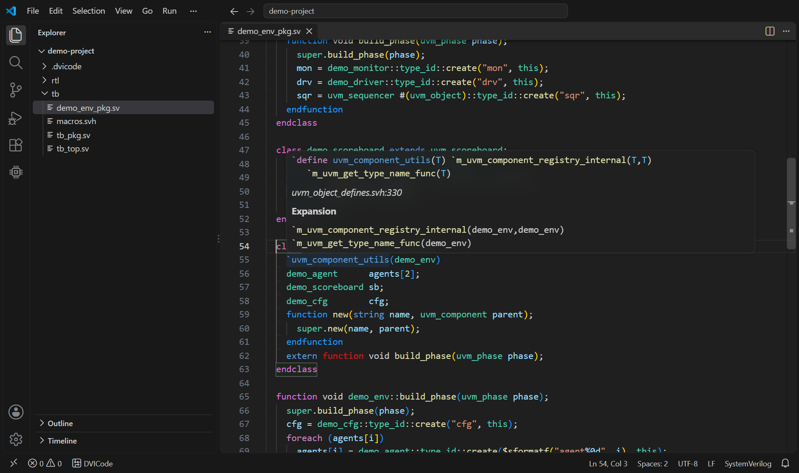
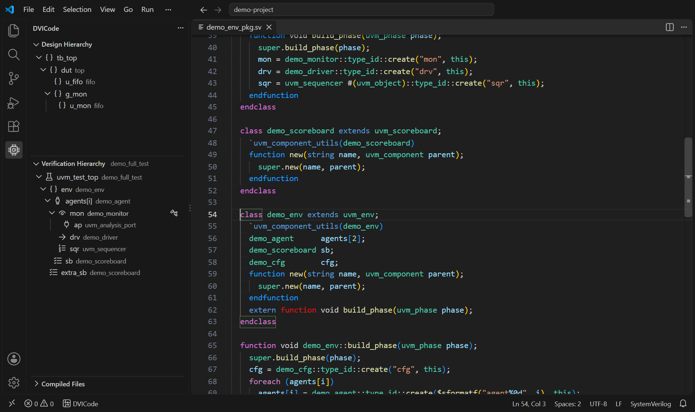
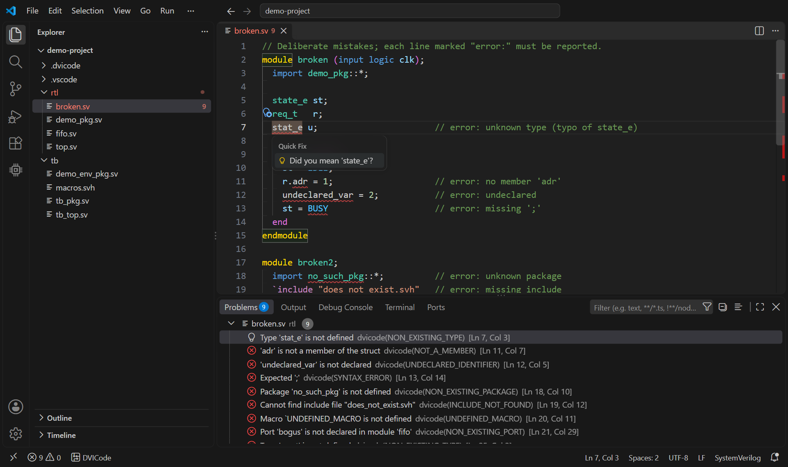

# DVICode: DV Intelligence for VS Code

[](https://marketplace.visualstudio.com/items?itemName=hexk.dvicode)
[](https://open-vsx.org/extension/hexk/dvicode)
[](LICENSE)

**Free, open-source SystemVerilog and UVM navigation for VS Code.**

Follow definitions across packages and class hierarchies, see what a macro expands to, and
explore your design and UVM testbench without starting a simulator. DVICode runs on your
desktop, in WSL, or beside your sources on a Linux server over SSH. Start with automatic
project discovery, then add your existing file lists for full control. Apache-2.0 licensed;
currently in preview.


## Features

- **Errors as you type**: undeclared names, unknown types, members and ports, missing
  includes and macros, syntax mistakes. Tested to report no problems on UVM 1.2, UVM 1.1d and
  the UBUS example, and no errors on OpenTitan, Ibex, core-v-verif, CVA6 and PULP AXI with
  their own file lists (see [the test corpus](scripts/corpus/README.md)).
- **Go anywhere**: definitions, references, implementations and overrides, through macros,
  packages, class inheritance and port connections; call and type hierarchies.
- **Smart completion**: members after `.`, package items after `::`, macros after `` ` ``,
  and complete module instantiations in one step.
- **Hover documentation**: signatures, doc comments and what a macro expands to.
- **Inlay hints**: port, parameter and argument names on positional connections and calls.
- **Override and implement**: complete an inherited method's name in a class to override it,
  or implement every pure virtual method left with one code action.
- **Design Hierarchy**: browse the instance tree from your top module.
- **UVM Verification Hierarchy**: explore the component hierarchy of the selected test
  (`+UVM_TESTNAME`), worked out from the source code the way UVM builds it: factory overrides
  applied, components made under a condition or in a loop marked, and, at the flip of a switch,
  the configuration objects, register model and sequences, with the sequencer each sequence
  starts on.
- **Structure**: the current file's modules, packages and classes grouped by what they hold
  (ports, signals, processes, fields, methods, the UVM phases...), with what a class inherits
  from each base class and which methods override.
- **Register Model**: the maps, registers, addresses and fields a UVM register block's
  `build()` creates, read from its construction code, with search by address.
- **Assertions and Coverage**: right-click a signal or field to see the assertions, covers and
  coverpoints that use it (as the checked value, a clock or a reset), through named
  properties, port connections and `bind`s, and covergroup `sample()` arguments.
- **uvm_config_db**: hover a `get` to see the `set` calls that can provide it (field, type
  and scope matched as UVM 1.2 matches them, through the test's component hierarchy), and a
  `set` for the `get` calls it reaches; go to definition from a field name to its sets.
- **Instance repair**: complete port and parameter names in an instance's lists, connect the
  missing ports, expand `.*`, turn ordered connections into named ones, and see ports
  connected twice or ordered and named connections mixed.
- **Factory override impact**: hover a `set_*_override*` call to see which components it
  changes in the test's modeled build, which it may change, and why others are not changed.
- **Drivers and Loads**: right-click a signal or port and choose Show Drivers or Show Loads to
  see where it is written (assignments, `force`, output arguments, gate outputs) or read,
  following port connections down into instances and up to where its module is instantiated.
  The places are found from the source, not by elaborating the design: interfaces, `alias`,
  `bind` instances and connections through expressions are not followed.
- **Filter and follow**: filter each view by name or path, and let it follow the editor:
  jump with **F12** or **Ctrl+click** and the view selects where you landed.
- **Macro expansion**: see exactly what a `` `uvm_* `` macro turns into, one level or all.
- **Type and call hierarchies**, outline, workspace symbol search, rename and semantic
  highlighting (inactive `` `ifdef `` code is dimmed).
- **Quick fixes**: "did you mean", "import package", "declare variable".
- **Uses your existing file lists**: point it at the simulator's `-f` files (the common
  options are supported, see [build files](docs/build-files.md)), or let it configure the
  project by itself.
- **Works where your sources live**: natively on Windows, Linux and macOS, in WSL, or on a
  Linux host over SSH, even for files that exist only on the server. Runs through
  `bsub`/`qrsh` too.
- **Lightweight**: a single engine of about 5 MB per platform, installed for you. It parses
  and indexes the whole UVM 1.2 library (142 files, 75,000 lines) in about 50 ms on a desktop
  PC ([how this was measured](docs/development.md#performance)).

| Macro hover | Design and UVM hierarchies | Problems and quick fixes |
|---|---|---|
| [](docs/images/hover.png) | [](docs/images/hierarchy.png) | [](docs/images/problems.png) |

## Getting started

1. **Install** the extension: in VS Code, open the Extensions view (**Ctrl+Shift+X**),
   search for **DVICode** and choose **Install**, or run
   `code --install-extension hexk.dvicode`. VSCodium, Cursor, Windsurf and other VS Code
   editors install it from [Open VSX](https://open-vsx.org/extension/hexk/dvicode). The
   test suite passes in **Cursor 3.26** and **VSCodium 1.140** too, with the engine on the
   same machine, in WSL and over SSH (DVICode's own SSH mode; their own remote windows are
   not tested).
   Without internet access, download the `.vsix` for your platform from the
   [releases page](https://github.com/hexkDotCom/dvicode/releases), then choose **...** >
   **Install from VSIX...** in the Extensions view.
2. **Open your project folder.** DVICode picks where to run:

   | Your setup | What happens |
   |---|---|
   | Windows, macOS or Linux desktop, files on a local drive | Runs on your computer. |
   | Windows, files in WSL (`\\wsl.localhost\Ubuntu\home\me\proj`) | Runs in that WSL distribution. |
   | Files on a Linux server | Run **DVICode: Open Folder on the Server...** and pick the SSH host. Needs SSH key or agent sign-in. |
   | Remote-SSH or Remote-WSL window | Runs next to your files on the remote side. |

   On Windows, set `dvicode.server.mode` to `wsl` to run in WSL instead, for example when
   `UVM_HOME` and your tools are set up there. Files on a Windows drive are then seen as
   `/mnt/<drive>/...`.
3. **Optional: describe the build.** Without a build file, DVICode finds your sources and
   works out the compile order. For full control, create `.dvicode/default.build` in the
   simulator's argument-file syntax:

   ```
   -uvm
   +incdir+tb/include
   +define+SIMULATION
   -f rtl/rtl.f
   tb/tb_pkg.sv
   tb/tb_top.sv
   +UVM_TESTNAME=base_test
   ```

   Everything that works in a build file is described in
   [docs/build-files.md](docs/build-files.md).

### Try it on the demo project

[examples/demo-project](examples/demo-project) is a small FIFO design with a UVM-style
testbench; it needs no UVM installation.

1. Open the `examples/demo-project` folder in VS Code. When **DVICode** in the status bar
   stops spinning, the project is compiled; click it to see what was found.
2. Open `tb/demo_env_pkg.sv`, put the cursor on `uvm_env` in `class demo_env extends uvm_env`
   and press **F12**: you land on the base class in the UVM package.
3. Open the **DVICode** view in the activity bar: the Verification Hierarchy shows the
   components `demo_full_test` builds. Right-click the `` `uvm_component_utils `` line and
   choose **Expand Macro One Level** to see the code it generates.
4. Run **DVICode: Set Current Build Configuration...** and pick `errors`: the Problems view
   lists the deliberate mistakes in `rtl/broken.sv`.

## Commands and views

- **DVICode** in the activity bar: Design Hierarchy (pick the top with **Select Design
  Hierarchy Top...**), Verification Hierarchy (pick the test with **Select UVM Test...**),
  Compiled Files and Structure. Each view's title bar has:
  - **Filter...** (funnel button): show only what matches and its parents. Plain text matches
    anywhere in a name or path, ignoring case (`fifo` finds `tb.dut.u_rx_fifo`); `*` matches
    within one level of a path, `**` across levels, `?` one character
    (`dut.*.mem`, `rtl/**.sv`). The Design Hierarchy matches instance names, module names and
    paths; the Verification Hierarchy component names, their classes and paths; Compiled
    Files file paths. On very large designs the view says when the search stopped early.
  - **Follow the Editor** (link button): the view selects what the cursor is in, without taking
    the focus from the editor: the instance of the module (on an instantiation line, that
    instance), the component built from the class, the file. When a module or class is used
    in several places the title shows "1 of N"; **Next** and **Previous**
    move between them, and the view stays on the one shown while you move
    inside the same module.

  Each view remembers its filter and whether it follows the editor, per build configuration.
  The commands are in the Command Palette too (**DVICode: Filter... (Design Hierarchy)**, ...).
- **Verification Hierarchy**: the components the selected test builds, found by following its
  `new` and `build_phase` (with `super` calls and helper methods) the way UVM runs them.
  - A component's class is the one the factory builds: overrides the test (or any component)
    sets with `set_type_override_by_type`, `set_inst_override_by_type`, `T::type_id::set_*`
    and the by-name forms are applied in the order UVM registers them; the tooltip lists them.
    An override set under a condition is not applied: the component says "may be overridden".
  - "conditional": created inside an `if` or `case` (the tooltip has the condition);
    "or B": another class is created instead in another branch; "×4": created in a loop of 4
    iterations (×? when the count is not a constant).
  - The **...** menu has **Show UVM Objects**: configuration objects, the register model (the
    block itself), adapters, and the sequences each component starts in its run-time phases,
    with the sequencer they start on and the sequences they start in turn; default sequences
    show under their sequencer. **Show TLM Ports** shows the ports, exports and imps, hidden by
    default (the tooltip of a component counts them).
- **Structure**: the declarations of the active editor's file: includes and defines; modules
  and interfaces with their parameters, ports, signals, instances, processes (`always_ff
  @(posedge clk)`, `assign y`), generate blocks, functions, assertions; packages; classes with
  their fields, constraints, covergroups and methods (UVM phases marked), then what each base
  class gives them ("overridden in", "overrides", "hides"); code `` `ifdef `` leaves out, by
  lines. It filters by name and follows the cursor.
- **DVICode: Expand Macro One Level**, **Expand Macro All Levels** and **Show Including
  File**; the first and last are also in the editor's context menu.
- **DVICode: Set Current Build Configuration...** to switch between `.dvicode/*.build` files.
- **DVICode: Show Project Status** (also the status bar item) and **Rebuild Project**.
- **DVICode: Report Issue** opens VS Code's issue reporter with your setup and the log filled
  in.
- **DVICode: Open Folder on the Server...** to work on files that live on a Linux host.

## Settings

| Setting | Default | Meaning |
|---|---|---|
| `dvicode.server.mode` | `auto` | Where the engine runs: `auto`, `local`, `wsl`, `ssh`, `tcp`, `custom` |
| `dvicode.server.wslDistro` | | WSL distribution (default: the folder's, else the default one) |
| `dvicode.server.sshHost`, `.sshArgs`, `.sshCommand` | | SSH destination and options |
| `dvicode.server.launchCommand` | `${SERVER_CMD}` | Wrapper for `custom`, e.g. `ssh farm bsub -Is ${SERVER_CMD}` |
| `dvicode.server.tcpAddress`, `.tcpToken` | `127.0.0.1:7777` | Attach to `DVICODE_TOKEN=T dvicode-server --listen HOST:PORT` (without a token the engine listens on loopback only) |
| `dvicode.server.path` | | Engine binary on the target (default: bundled, installed to `~/.dvicode/server/`) |
| `dvicode.server.autoDeploy` | `true` | Install the bundled engine on WSL and SSH targets (Linux x64; for other hosts, build the engine there and set `dvicode.server.path`) |
| `dvicode.pathMappings` | `[]` | Same folder seen by both sides, e.g. `[{ "local": "Z:\\proj", "remote": "/home/me/proj" }]` |
| `dvicode.buildFile` | | Build configuration (relative to the folder), or `auto` |
| `dvicode.env` | `{}` | Variables for `$VAR` in build files |
| `dvicode.uvmHome` | | UVM location for `-uvm` when `$UVM_HOME` is not set |
| `dvicode.server.logLevel` | `info` | Engine log in the DVICode output channel; `debug` shows how the build file or the folder was read, `trace` every file |
| `dvicode.maxProblems` | `1000` | Problems shown after a full build. Open files are exempt from this limit; per-file limits still apply |

## FAQ

**Does it need a simulator or a license?** No. DVICode reads your sources itself; a
simulator's file lists are only used as input.

**Where is my code processed?** Only by the engine, which runs where your files are: on your
computer, in WSL, or on your server. The extension sends no telemetry and makes no network
requests of its own; in SSH mode it uses your SSH connection. Problem reports are only sent
when you submit one yourself.

**What if something goes wrong inside DVICode?** The feature that failed reports an internal
error, the rest keeps working, and a notice offers **Report Issue** and **Show Log**. If the
engine itself stops, it is restarted (up to 4 times in 3 minutes). **DVICode: Report Issue**
fills in the details; review them before you submit, since the log can contain file
names.

**How do I set up UVM?** Put `-uvm` in the build file and set `UVM_HOME` (or the
`dvicode.uvmHome` setting, or `-uvmhome DIR` in the build file) to the UVM installation.
Auto-configuration adds UVM by itself when the sources use it.

**DVICode reports errors on code that compiles. How do I find out why?** Most often the
project is read differently from your simulator's flow: a missing define, include directory or
file. Set `dvicode.server.logLevel` to `debug` and choose **Restart Server** when DVICode
offers it: the DVICode output channel then shows every argument file read and what it
added, or, without a build file, which folders were skipped and why, headers that no file
includes, included files that are not in the folder and packages defined more than once.
`trace` also lists every file in compile order. On the command line,
`dvicode-server check <folder> --log-level debug` prints the same.

**Can it run next to another SystemVerilog extension?** Yes, but both will report problems
and offer completions. If that is noisy, turn those features off in the other extension's
settings, or disable it for the workspace.

**Can one window hold several projects?** One window works with one engine and one project:
the first workspace folder decides where the engine runs and which build file it uses. Open
other projects, or folders on other hosts, in their own windows.

**I changed files on the server outside VS Code; why don't the problems update?** Files of a
**DVICode: Open Folder on the Server...** folder are not watched for changes made by other
programs. Run **DVICode: Rebuild Project**, which reads every file again.

**What doesn't it do yet?** See [Status](#status).

## How it works

```
 VS Code on Windows / macOS / Linux          Where your files are: this computer,
                                             WSL2, or a Linux host over SSH
 ┌──────────────────────────────┐  LSP over  ┌───────────────────────────────────┐
 │ DVICode extension            │  stdio of  │ dvicode-server (Rust)             │
 │  starts the engine where     │  the       │  build file → compile order       │
 │  your files are, maps paths  │  engine    │  preprocessor, tolerant parser    │
 │  hierarchy and file views    │ ─────────▶ │  index, resolution, IDE features  │
 └──────────────────────────────┘            └───────────────────────────────────┘
```

The extension starts the engine directly, or through `wsl.exe` or `ssh`, and talks the
Language Server Protocol over that process's input and output. The WSL and SSH modes
therefore need no extra port for the language server; the optional `tcp` mode attaches to an
engine you started yourself. Such an engine needs a token (`DVICODE_TOKEN`, and the same value
in `dvicode.server.tcpToken`) to listen on any address but loopback, since whoever connects
can read and write that account's files; the connection is not encrypted, so across a network
listen on `127.0.0.1` and use an SSH tunnel (`ssh -L 7777:127.0.0.1:7777 host`), or the `ssh`
mode, which needs no port. In Restricted Mode, a `dvicode://` folder reaches an SSH or TCP
engine only when your own settings name it; trust the workspace to use another. On Windows the engine reads network paths (`\\host\share\...`, which can make
Windows sign in to that host) only on the hosts VS Code allows (`security.allowedUNCHosts`);
a build file or `` `include `` naming another host gets a problem instead. See
[docs/architecture.md](docs/architecture.md) for the details.

## Status

DVICode is young and moving fast. Not supported yet: VHDL, e and PSS; elaboration of
parameter values and `generate` conditions; a view of every config-db setting;
diagrams; code formatting; lint rules.

**Help us improve it:** try it on your project, and when something is wrong, run
**DVICode: Report Issue** (or open an issue) with a minimal code sample that shows it, your
build file, your platform and setup (local, WSL or SSH), and what you expected to see.

## Contributing

Building, testing and the code layout are described in
[docs/development.md](docs/development.md).

## License

Apache License 2.0, see [LICENSE](LICENSE) and [NOTICE](NOTICE). Third-party components and
their licenses are listed in [THIRD_PARTY_NOTICES.md](THIRD_PARTY_NOTICES.md).
